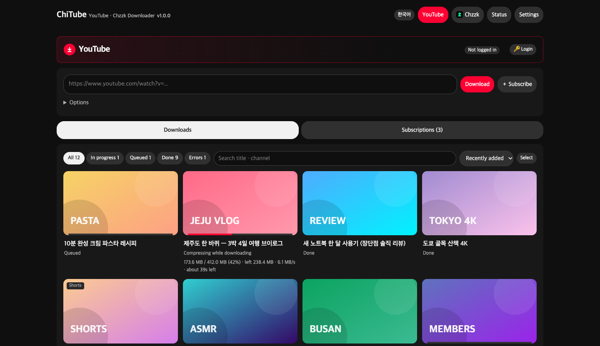

<p align="center">
  
</p>

<p align="center">
  <a href="CHANGELOG.en.md"></a>
  <a href="LICENSE"></a>
  
  
  
  
</p>

<p align="center"><a href="README.md">한국어</a> · <b>English</b></p>

<p align="center">
  <b>Subscribe to channels and ChiTube downloads new videos on its own — and starts recording live streams the moment they go live.</b><br>
  A self-hosted Docker app with a web UI. Installs the same way on a NAS, Linux server, Mac or Windows.
</p>

<p align="center">
  <a href="#-quick-start">Quick start</a> ·
  <a href="#-features">Features</a> ·
  <a href="docs/MANUAL.en.md">User manual</a> ·
  <a href="#-faq">FAQ</a> ·
  <a href="CHANGELOG.en.md">Changelog</a>
</p>

---

<p align="center">
  
</p>

> The web UI can be switched to **English** with the button at the top right. See the **[user manual](docs/MANUAL.en.md)** for details (per-platform install guides are linked below).

## 🚀 Quick start

Requirement: **Docker** (with Docker Compose v2)

```sh
git clone https://github.com/aodrha03/chitube.git
cd chitube
docker compose up -d --build
```

Open **`http://<server>:8945`** in your browser. It works with the default settings out of the box.

| Folder | Contents |
|---|---|
| `downloads/` | Downloaded videos (use `DOWNLOAD_DIR` in `.env` to point to another disk) |
| `config/` | Settings, database and login info |

### 📦 Install packages

Get the file for your platform from [Releases](https://github.com/aodrha03/chitube/releases/latest). Each zip contains a short install guide in Korean (`설치방법.md`) and English (`INSTALL.en.md`).

| Platform | File | Notes |
|---|---|---|
| Synology (DSM 7.2+) | `chitube-<ver>-synology.zip` | [Synology install](docs/install/synology.en.md) |
| Linux · macOS | `chitube-<ver>-linux.zip` (or `git clone`) | [Linux install](docs/install/linux.en.md) |
| Portainer | Stack from this repository URL (or `chitube-<ver>-portainer.zip`) | [Portainer install](docs/install/portainer.en.md) |
| Windows | `chitube-<ver>-windows.zip` — double-click **`시작.bat`** (start) | [Windows install](docs/install/windows.en.md) |

## ✨ Features

| |  |  |
|---|---|---|
| **Download by URL** | Videos · Shorts · Live · Playlists | Replays · Live streams |
| **Subscriptions** | Channels · playlists, check every 30 min – 1 day | Channels, live checked **every 10 s** → record immediately |
| **Login** | Members-only videos | Age-restricted videos |
| **Speed** | Slow on purpose to avoid blocks (1 at a time) | Replays split into 8 parallel connections |

### 🎬 Compression
- **H.265 · H.264 · AV1** quality presets, or keep the **original**
- Compress **while downloading** — no temp files, only the compressed file hits the disk (set per platform)
- **Encode** (re-compress later) for videos you kept in original quality, and **Delete with files**; compression runs in its own slots, so the next download starts right away
- Uses **Intel Quick Sync / NVIDIA NVENC** automatically, falls back to CPU
- Measures your GPU at startup and sets how many live streams it can compress at once

### 🔴 Live recording
- Starts recording **within 10 s** of a subscribed channel going live
- If a recording breaks, it **continues in a new file within seconds** and logs when and how long it was cut
- When the stream ends, split parts are **merged into one file automatically**
- Streams that were cut are **filled in from the replay** (Chzzk)
- After recording: a **quality check** for frozen video and silence
- **Live preview** of the last 10 s while recording

### 📺 Plex · Jellyfin ready
- Channel = show, upload year = season, date + index = episode
- Thumbnail · subtitles (.srt) · .nfo saved next to each video, plus a channel poster
- YouTube chapters embedded (optional: SponsorBlock segments **marked** as chapters, never cut)

```
YouTube/Channel/Season 2026/Channel - s2026e101801 - 2026-10-18 - Title [videoID].mp4
```

### 🛡️ Runs unattended
- **Watchdog**: stalled recordings and downloads are cleaned up within minutes and resumed or retried
- Network/server errors are retried after 1 → 5 → 15 minutes; full **audit twice a day** for missed or broken files
- Pauses automatically when YouTube signals a block, and when disk space runs low
- **Never deletes your downloads** — re-downloading only replaces a file after the new one succeeds
- Updates wait until live recordings finish · **diagnostics file** for troubleshooting

### 🧰 Convenience
- Subscription **filters** (title include/exclude, minimum length)
- Search, 7 sort orders, bulk actions, per-channel disk usage, stream-time heatmap
- Settings & subscriptions **backup / restore**
- UI in **Korean / English**

## ❓ FAQ

<details>
<summary><b>Does it run on a Synology NAS?</b></summary>

Yes, with Container Manager on DSM 7.2+. Intel models use Quick Sync for faster compression; ARM models use the CPU.
</details>

<details>
<summary><b>Do I need to set up my GPU?</b></summary>

Intel integrated graphics are connected automatically. For NVIDIA, install the NVIDIA Container Toolkit on the server and set it as the default runtime once. Docker Desktop on Mac/Windows cannot use the GPU, so it compresses on the CPU.
</details>

<details>
<summary><b>Will YouTube block me?</b></summary>

The defaults are deliberately slow (1 download at a time, 15–45 s between videos, 100 per day). If YouTube signals a block, ChiTube pauses automatically. Raising concurrency increases the risk.
</details>

<details>
<summary><b>Can I copy a file while it is being recorded?</b></summary>

**No — on any OS.** Copying or moving a file that is still downloading/recording can stall the recording. Use **▶ Preview** in the video info window instead, and copy files after they show **Done**.
</details>

<details>
<summary><b>Can I open it to the internet?</b></summary>

**No.** The web UI has no password and can access server folders and your logged-in accounts. Use a VPN (Tailscale, WireGuard, …) to reach it from outside.
</details>

## ⚠️ Notes

- **The web UI has no password.** Do not expose it to the internet (e.g. via port forwarding).
- This is a tool for personal archiving and backup. You are responsible for respecting copyright and each platform's terms of service.
- The `config/` folder (login cookies, settings, DB) is as sensitive as your account. Do not share it or commit it (excluded by `.gitignore`).
- **Trademarks**: YouTube is a trademark of Google LLC, and Chzzk (치지직) is a trademark of NAVER Corp. ChiTube is an unofficial tool, not affiliated with, sponsored or endorsed by either company.

## 🙏 Built with

[yt-dlp](https://github.com/yt-dlp/yt-dlp) · [FFmpeg](https://ffmpeg.org/) · [FastAPI](https://fastapi.tiangolo.com/) · [Uvicorn](https://www.uvicorn.org/) · [deno](https://deno.com/) · [aria2](https://aria2.github.io/) · [noVNC](https://novnc.com/) · [SVT-AV1](https://gitlab.com/AOMediaCodec/SVT-AV1)

## 📄 License

[MIT](LICENSE) © 2026 Lee Myung Gyun
