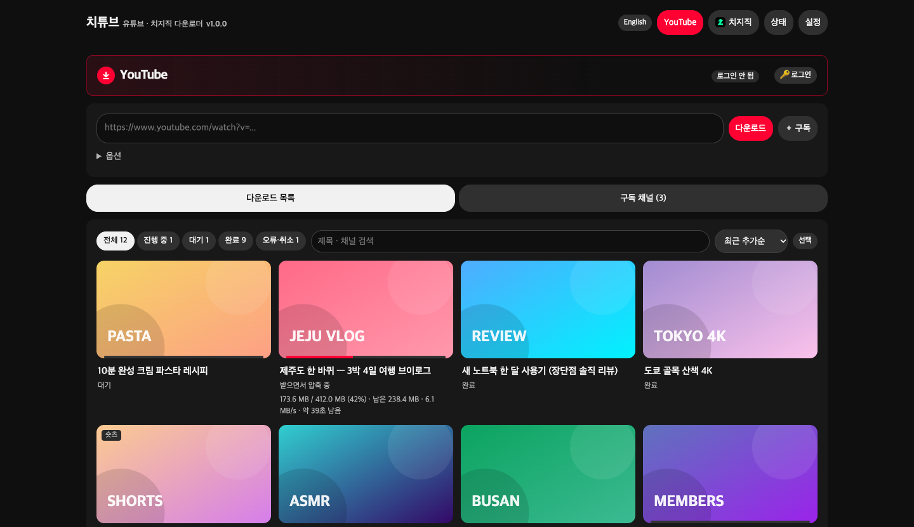
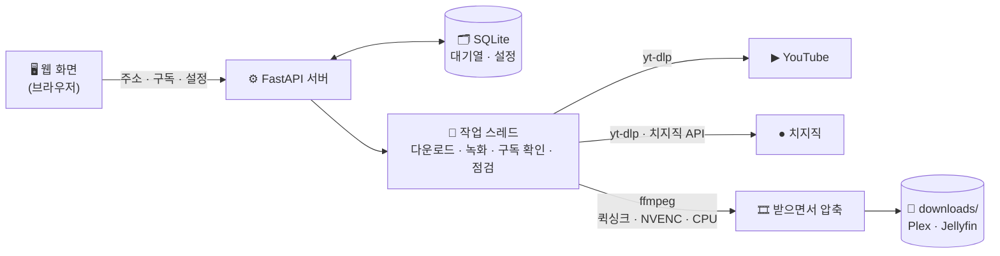

<p align="center">
  
</p>

<p align="center">
  <a href="CHANGELOG.md"></a>
  <a href="LICENSE"></a>
  
  
  
  
  
</p>

<p align="center">
  
  
  
  
  
</p>

<p align="center">
  <b>채널을 구독해 두면 새 영상을 알아서 받고, 생방송은 시작하자마자 녹화합니다.</b><br>
  웹 화면 하나로 쓰는 Docker 앱 — NAS · 리눅스 서버 · 맥 · 윈도우 어디서나 같은 방법으로 설치됩니다.
</p>

<p align="center">
  <a href="#-빠른-시작">빠른 시작</a> ·
  <a href="#-스크린샷">스크린샷</a> ·
  <a href="#-주요-기능">주요 기능</a> ·
  <a href="docs/MANUAL.md">사용 설명서</a> ·
  <a href="#-자주-묻는-질문">FAQ</a> ·
  <a href="CHANGELOG.md">변경 기록</a>
</p>

---

<p align="center">
  
</p>

## 🚀 빠른 시작

필요한 것: **Docker** (Docker Compose v2 포함)

```sh
git clone https://github.com/aodrha03/chitube.git
cd chitube
docker compose up -d --build
```

브라우저에서 **`http://서버주소:8945`** 를 열면 끝입니다. 설정을 하나도 바꾸지 않아도 기본값으로 동작합니다.

| 저장 위치 | 내용 |
|---|---|
| `downloads/` | 받은 영상 (`.env` 의 `DOWNLOAD_DIR` 로 다른 디스크 지정 가능) |
| `config/` | 설정 · 데이터베이스 · 로그인 정보 |

### 📦 환경별 설치 파일

[Releases](https://github.com/aodrha03/chitube/releases/latest) 에서 내 환경에 맞는 파일을 받으세요. 압축을 풀면 맨 위의 **`설치방법.md`** 가 그 환경의 순서를 알려 줍니다.

| 환경 | 받을 파일 | 설치 순서 |
|---|---|---|
| 시놀로지 (DSM 7.2+) | `chitube-버전-synology.zip` | [시놀로지 설치](docs/install/synology.md) |
| 리눅스 · 맥 | `chitube-버전-linux.zip` (또는 `git clone`) | [리눅스 설치](docs/install/linux.md) |
| 포테이너 | 파일 없이 저장소 주소로 바로 (또는 `chitube-버전-portainer.zip`) | [포테이너 설치](docs/install/portainer.md) |
| 윈도우 | `chitube-버전-windows.zip` — **`시작.bat` 더블클릭** | [윈도우 설치](docs/install/windows.md) |

> 예전 이름(`docker_youtube`)으로 쓰던 분은 컨테이너 이름이 `chitube` 로 바뀌었습니다. 각 설치 순서의 **"예전 이름(docker_youtube)에서 옮겨 올 때"** 를 한 번 따라 하면 설정 · 영상이 그대로 이어집니다.

## 📸 스크린샷

> 스크린샷은 데모용 가짜 데이터로 찍었습니다.

| YouTube — 다운로드 목록 | 치지직 — 생방송 녹화 |
|:---:|:---:|
|  |  |
| **구독 채널 — 채널마다 화질 · 경로 · 주기** | **영상 정보 — 재생 · 녹화 끊김 기록 · 조각 합치기** |
|  |  |
| **상태 — 시스템 · 자동 점검 · 확인 일정** | **설정 — 코덱별 화질 프리셋** |
|  |  |

<details>
<summary><b>🌐 English UI</b> — 오른쪽 위 버튼으로 화면 언어 전환</summary>
<br>

</details>

## ✨ 주요 기능

| |  |  |
|---|---|---|
| **주소로 바로 받기** | 영상 · 숏츠 · 라이브 · 재생목록 | 다시보기 · 생방송 |
| **구독 (새 영상 자동)** | 채널 · 재생목록, 확인 주기 30분 ~ 하루 | 채널, 생방송은 **10초마다** 확인 → 바로 녹화 |
| **로그인** | 멤버십 영상 | 성인 인증 영상 |
| **받는 속도** | 차단 예방을 위해 천천히 (동시 1개) | 다시보기 하나를 8갈래로 나눠 빠르게 |

### 🎬 받으면서 바로 압축
- **H.265 · H.264 · AV1** 화질 프리셋 (원본급 · 고화질 · 표준 · 용량 절약) 또는 **원본 그대로**
- 다 받은 뒤가 아니라 **받는 동안 압축** → 임시 파일 없이 압축본만 디스크에 (유튜브 · 치지직 따로 설정)
- 원본으로 받은 영상도 **나중에 압축** · 압축 개수를 다운로드 개수와 따로 (압축 중에도 다음 영상을 받음)
- **인텔 퀵싱크 · 엔비디아** 그래픽카드를 자동으로 찾아 사용, 없거나 실패하면 CPU
- 압축해도 작아지지 않는 영상은 원본 화질 그대로 저장

### 🔴 생방송 녹화
- 구독한 채널이 방송을 켜면 **10초 안에** 녹화 시작
- 녹화가 끊기면 **몇 초 안에 이어서** 녹화하고, 끊긴 시각 · 빠진 시간을 기록
- 방송이 끝나면 나뉜 녹화 파일을 **자동으로 한 파일로** (버튼으로도, 형식이 다르면 다시 압축해서 합침)
- 녹화 썸네일이 없으면 녹화 장면으로 만들어 둠 · 구독 채널의 **방송 시간 패턴**(요일 × 시간)
- 녹화 중에도 **미리보기** — 최근 10초를 저장되는 화질 그대로 재생
- 녹화한 방송은 나중에 올라오는 **다시보기를 또 받지 않음** (녹화가 일부만 담았으면 다시보기도 받음)

### 📺 Plex · Jellyfin 에 바로
- 채널 = 쇼, 업로드 연도 = 시즌, 날짜 + 순번 = 에피소드
- 영상마다 **썸네일 · 자막(.srt) · nfo** 를 함께 저장, 채널 포스터까지
- 유튜브 설명란 타임스탬프를 **챕터**로 넣어 플레이어에서 구간 이동 (선택: SponsorBlock 광고 구간을 챕터로 **표시만**)

```
YouTube/채널명/Season 2026/채널명 - s2026e101801 - 2026-10-18 - 제목 [영상ID].mp4
```

### 🛡️ 알아서 관리
- **하루 2번 자동 점검** — 놓친 영상 · 손상된 파일 · 실패한 다운로드를 찾아 다시 받기
- 유튜브 **차단 신호를 감지하면 자동으로 쉬었다가** 다시 시작
- 디스크 공간이 부족하면 새 다운로드를 멈추고, 공간이 생기면 다시 시작
- **원본이 지워져도 받은 영상은 그대로** — 다시 받기에 실패해도 기존 파일 보존

### 🧰 편의
- 구독 **필터** — 제목 포함 · 제외 단어, 최소 길이
- 제목 · 채널 **검색**, 7가지 **정렬**, 여러 개 골라 한 번에 처리, 상태 화면의 **채널별 용량**
- **설정 · 구독 백업 / 복원** — 서버를 옮길 때 파일 하나로
- 화면 언어 **한국어 / English**
- 프로그램(yt-dlp) 업데이트를 웹 화면에서 버튼 하나로

## 🏗️ 구조



| 구성 | 사용 기술 |
|---|---|
| 서버 | Python 3.12 · FastAPI · SQLite |
| 다운로드 | yt-dlp · aria2 (치지직 다시보기 나눠 받기) · deno |
| 압축 | ffmpeg (libx265 · SVT-AV1 · Intel VAAPI · NVIDIA NVENC) |
| 로그인 | 컨테이너 안 Chromium + noVNC (내 브라우저 창에서 직접 로그인) |
| 화면 | HTML 한 파일 (프레임워크 없음) |

## ⚙️ 기본값 한눈에

| 항목 | 기본값 | 바꾸는 곳 |
|---|---|---|
| 화질 | H.265 **표준**, 최대 1080p | 설정 → YouTube / 치지직 |
| 압축 방식 | 받으면서 바로 압축 | 설정 → 공통 |
| 하드웨어 가속 | 자동 (엔비디아 → 인텔 퀵싱크 → CPU) | 설정 → 공통 |
| 유튜브 동시 다운로드 | 1개 · 24시간 최대 100개 | 설정 → YouTube |
| 치지직 동시 다운로드 · 녹화 | 2개 · 5개 | 설정 → 치지직 |
| 구독 확인 주기 | 6시간 (치지직 생방송은 10초) | 설정 · 구독 채널별 |
| 자동 점검 | 하루 2번 (새벽 4시 · 오후 4시) | 설정 → 공통 |
| 최소 여유 공간 | 20 GB | 설정 → 공통 |

## ❓ 자주 묻는 질문

<details>
<summary><b>NAS(시놀로지)에서 돌아가나요?</b></summary>

네. DSM 7.2 이상 Container Manager 에서 프로젝트를 만들면 됩니다. 인텔 CPU 모델은 퀵싱크로 압축이 빨라지고, ARM 모델은 CPU 로 동작합니다. → [시놀로지 설치](docs/MANUAL.md#시놀로지-dsm-72-이상)
</details>

<details>
<summary><b>그래픽카드 설정을 따로 해야 하나요?</b></summary>

인텔 내장 그래픽은 자동으로 연결됩니다. 엔비디아는 서버에 NVIDIA Container Toolkit 을 설치하고 한 번만 기본 런타임으로 설정하면 됩니다. 맥 · 윈도우 Docker Desktop 은 구조상 GPU 를 못 써서 CPU 로 압축합니다. → [하드웨어 가속](docs/MANUAL.md#하드웨어-가속)
</details>

<details>
<summary><b>유튜브에 차단당하지 않나요?</b></summary>

기본값이 천천히 받도록 맞춰져 있습니다 (동시 1개, 영상 사이 15~45초, 하루 100개). 차단 신호가 오면 자동으로 1시간 쉽니다. 동시 다운로드 수를 올리면 차단 위험이 커집니다.
</details>

<details>
<summary><b>멤버십 · 성인 인증 영상도 받을 수 있나요?</b></summary>

본인 계정으로 로그인하면 됩니다. 웹 화면의 🔑 로그인 → 브라우저 열기 → 평소처럼 로그인. 볼 수 있는 권한이 있는 영상만 받을 수 있습니다. → [로그인](docs/MANUAL.md#5-로그인-멤버십--성인-인증-영상)
</details>

<details>
<summary><b>녹화 중인 파일을 복사하거나 옮겨도 되나요?</b></summary>

**아니요, 어떤 OS 에서든 받는 중 · 녹화 중인 파일은 복사하거나 옮기지 마세요.** 복사 · 이동하는 방법(탐색기 · Finder · 네트워크 공유)과 Docker 가 폴더를 연결하는 방식에 따라 녹화가 멈추거나, 끝날 때 파일을 찾지 못해 정리 · 압축이 안 될 수 있습니다. 녹화 중 확인은 영상 정보 창의 **▶ 지금 받는 부분 확인**(미리보기)을 쓰고, 복사 · 이동은 카드가 **완료**가 된 뒤에 하세요. (녹화가 멈추면 90초 뒤 자동으로 그때까지 녹화분을 저장하고 새 파일로 이어서 녹화하지만, 멈춘 동안은 빠집니다)
</details>

<details>
<summary><b>스트리머가 영상을 지우면 받은 파일도 지워지나요?</b></summary>

아니요. 이 프로그램은 받은 영상을 자동으로 지우지 않습니다. '다시 받기'를 눌러도 새로 받기에 성공해야 기존 파일을 바꾸고, 실패하면 기존 파일이 그대로 남습니다. 점검 때 채널에서 사라진 영상은 **원본 사라짐** 으로 표시만 됩니다.
</details>

<details>
<summary><b>밖에서(인터넷으로) 접속해도 되나요?</b></summary>

**안 됩니다.** 웹 화면에는 비밀번호가 없고, 서버 폴더와 로그인된 계정에 접근할 수 있습니다. 밖에서 쓰려면 VPN(Tailscale, WireGuard 등)으로 집 네트워크에 들어와서 접속하세요.
</details>

<details>
<summary><b>업데이트는 어떻게 하나요?</b></summary>

유튜브가 바뀌어 안 받아질 때는 상태 탭 → **재시작해서 업데이트** (yt-dlp 최신 설치). 이 프로그램 자체는 새 파일을 받고 `docker compose up -d --build`. 설정 · 기록은 `config/` 에 그대로 남습니다.
</details>

더 많은 내용은 **[사용 설명서](docs/MANUAL.md)** 의 [문제 해결](docs/MANUAL.md#11-문제-해결)을 보세요.

## ⚠️ 주의

- **웹 화면에는 비밀번호가 없습니다.** 공유기 포트포워딩 등으로 인터넷에 열지 마세요.
- 개인 소장 · 백업 용도의 도구입니다. 받은 영상의 저작권과 각 플랫폼(YouTube · 치지직) 이용약관을 지키는 책임은 사용자에게 있습니다.
- `config/` 폴더(로그인 쿠키 · 설정 · DB)는 계정 정보와 같습니다. 공유하거나 저장소에 올리지 마세요. (`.gitignore` 에서 제외됨)
- **상표 고지**: YouTube 는 Google LLC 의, 치지직(CHZZK)은 NAVER Corp. 의 상표입니다. 치튜브는 두 회사와 관련이 없는 비공식 도구이며, 두 회사의 후원이나 승인을 받지 않았습니다.

## 🙏 사용한 오픈소스

[yt-dlp](https://github.com/yt-dlp/yt-dlp) · [FFmpeg](https://ffmpeg.org/) · [FastAPI](https://fastapi.tiangolo.com/) · [Uvicorn](https://www.uvicorn.org/) · [deno](https://deno.com/) · [aria2](https://aria2.github.io/) · [noVNC](https://novnc.com/) · [SVT-AV1](https://gitlab.com/AOMediaCodec/SVT-AV1)

## 📄 라이선스

[MIT](LICENSE) © 2026 Lee Myung Gyun

<sub>YouTube 는 Google LLC 의, 치지직(CHZZK)은 NAVER Corp. 의 상표입니다. 치튜브는 두 회사와 관련이 없는 비공식 도구이며, 두 회사의 후원이나 승인을 받지 않았습니다.</sub>
