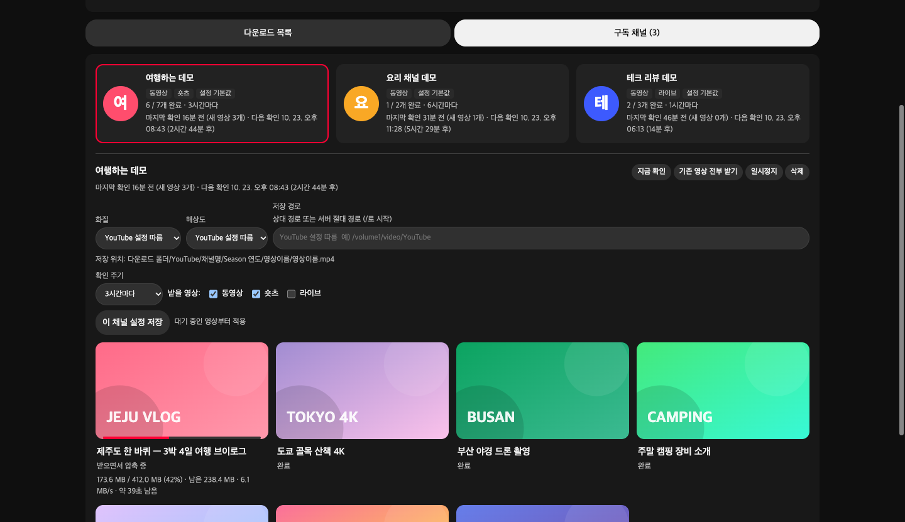
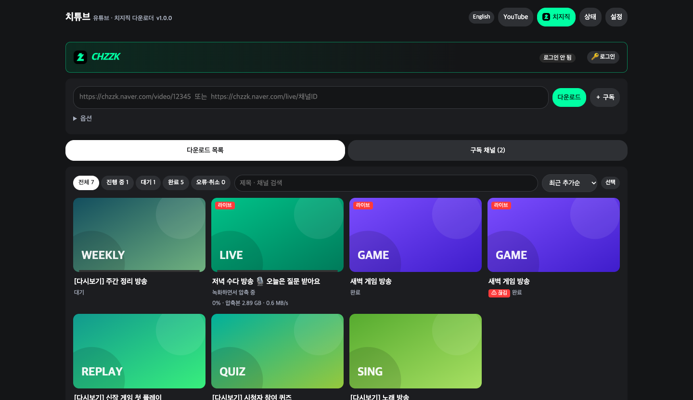
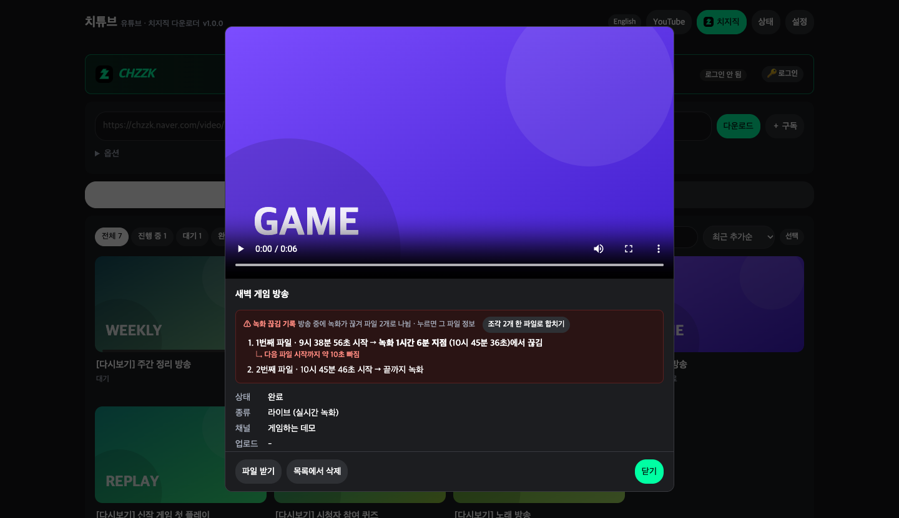
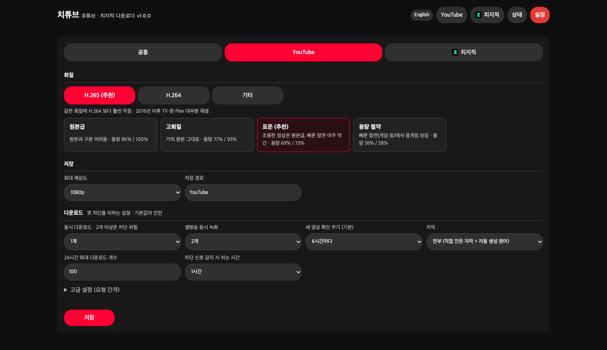
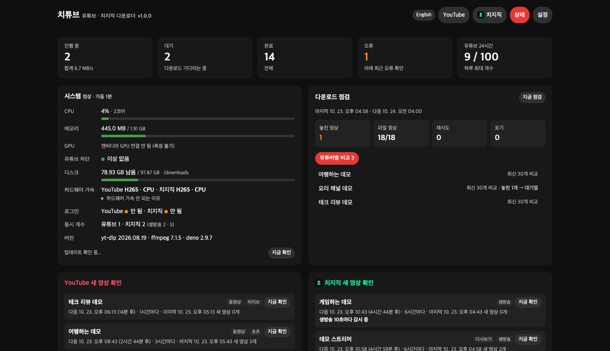

# ChiTube User Manual

[← README](../README.en.md) · [한국어](MANUAL.md) · **English**

> YouTube is a trademark of Google LLC, and Chzzk (치지직) is a trademark of NAVER Corp. ChiTube is an unofficial tool, not affiliated with, sponsored or endorsed by either company.

> The web UI can be switched to English with the **English** button at the top right. Menu names below follow the English UI. Folder names created on disk (e.g. `Season 2026`) are the same in both languages.

## Contents

1. [Installation](#1-installation)
   - [Linux · macOS · Windows](#linux--macos--windows) · [Synology (DSM 7.2+)](#synology-dsm-72) · [Portainer](#portainer)
2. [Tour of the UI](#2-tour-of-the-ui)
3. [Downloading · Subscriptions](#3-downloading--subscriptions)
4. [Live recording](#4-live-recording)
5. [Login (members-only · age-restricted videos)](#5-login-members-only--age-restricted-videos)
6. [Quality · Compression · Hardware acceleration](#6-quality--compression--hardware-acceleration)
7. [Save location · Plex · Jellyfin](#7-save-location--plex--jellyfin)
8. [Status page · Automatic audit](#8-status-page--automatic-audit)
9. [Avoiding YouTube blocks](#9-avoiding-youtube-blocks)
10. [Backup · Updates](#10-backup--updates)
11. [Troubleshooting](#11-troubleshooting)

---

## 1. Installation

> Short per-platform guides: [Synology](install/synology.en.md) · [Linux · macOS](install/linux.en.md) · [Portainer](install/portainer.en.md) · [Windows](install/windows.en.md)

On every platform, put the **whole project folder** (`Dockerfile`, `entrypoint.sh`, `docker-compose.yml`, `app/`, and the empty `config/` and `downloads/` folders) on the server and run it with `docker-compose.yml`. It works with the defaults, so you don't need to edit any file.

When it's running, open `http://<server>:8945` in your browser.

> ⚠ Don't remove `restart: unless-stopped` from `docker-compose.yml`. The "Restart to update" button relies on it to start ChiTube again.

### Linux · macOS · Windows

Requirements: Docker + Docker Compose v2 (the `docker compose` command). On Windows, WSL or Docker Desktop.

```sh
cd chitube
docker compose up -d --build
```

**Change the save location / file owner (optional)**

```sh
cp .env.example .env
nano .env          # edit DOWNLOAD_DIR, PUID, PGID
docker compose up -d
```

| Setting | Meaning | Example |
|---|---|---|
| `PORT` | Web UI port | `8945` |
| `DOWNLOAD_DIR` | Where videos are saved (default `./downloads`) | `/mnt/hdd/YouTube`, external drive on Mac `/Volumes/Drive/YouTube` |
| `PUID` / `PGID` | Owner of saved files — uid/gid from the `id` command (keep 0 on Mac) | `1000` / `1000` |
| `TZ` | Time zone | `Asia/Seoul` |

To use an external drive on a Mac, add `/Volumes` under Docker Desktop → Settings → File sharing.

**Windows**: unzip `chitube-<ver>-windows.zip` and double-click **`시작.bat`** (start). `중지.bat` stops it. Settings and videos are kept.

### Synology (DSM 7.2+)

1. Install **Container Manager** from Package Center.
2. In **File Station**, create a `docker/chitube` folder and upload the whole project folder.
   - The empty `config/` and `downloads/` folders must be there too. Synology doesn't create missing folders, so you'd get `Bind mount failed: '.../config' does not exist`. If they were skipped during upload, create them in File Station.
3. **Container Manager → Project → Create**
   - Path: `docker/chitube` (the folder with the compose file)
   - Source: "Use existing docker-compose.yml" → Next → Done (the first build takes a few minutes)
4. Open `http://<NAS>:8945`

> ⚠ **Keep PUID/PGID in `.env` at the default 0.** Synology creates the `config` and `downloads` folders as root, so changing PUID to e.g. 1026 makes the container restart forever with `unable to open database file`.

- Saving to another shared folder or USB: set `DOWNLOAD_DIR=/volume1/video/YouTube` in `.env` (USB: `/volumeUSB1/usbshare/YouTube`). Create the folder in File Station first.
- Only if you want files owned by your account: over SSH run `sudo chown -R 1026:100 <config folder> <save folder>`, then set `PUID=1026`, `PGID=100` in `.env` (your own `id` values).
- Synology CPUs compress slowly. Use **Original** or **H.264 Standard** quality and compression speed `veryfast` or faster. Intel models get Quick Sync automatically (ARM models use the CPU only).

### Portainer

ChiTube builds its own image, so the Web editor alone won't work.

**Option A — Repository (recommended)**

1. Stacks → **Add stack** → name `chitube`
2. Build method: **Repository** → Repository URL `https://github.com/aodrha03/chitube`, reference `refs/heads/main`, Compose path `docker-compose.yml`
3. (Optional) Environment variables `DOWNLOAD_DIR`, `PUID`, `PGID`
4. **Deploy the stack** — to update later: **Pull and redeploy**

**Option B — Build the image on the server, then a stack**

```sh
cd chitube
docker build -t chitube:latest .
```

Stacks → Add stack → paste into the Web editor (use real server paths):

```yaml
services:
  youtube:
    image: chitube:latest
    container_name: chitube
    ports:
      - "8945:8000"
    environment:
      - TZ=Asia/Seoul
      - PUID=0
      - PGID=0
    volumes:
      - /opt/chitube/config:/config
      - /mnt/hdd/YouTube:/downloads
      - /:/host                      # to use absolute server paths as save locations
    device_cgroup_rules:
      - "c 226:* rmw"                # connects Intel Quick Sync automatically
    restart: unless-stopped
```

---

## 2. Tour of the UI

<p align="center"></p>

| Tab | What it does |
|---|---|
| **YouTube** / **Chzzk** | Download or subscribe by URL, download list (search · sort · multi-select), subscriptions, login |
| **Status** | Active · queued · done · error counts, system (CPU · memory · disk · hardware acceleration), audit results, subscription schedule, recent activity · errors |
| **Settings** | Common / YouTube / Chzzk settings, settings & subscription backup |

- The **English / 한국어** button at the top right switches the UI language (remembered by your browser).
- Click a video to open the **video info** window: playback, original and saved quality/size, Re-download · Download file · Remove from list.
- **Remove from list** only removes the entry — **the file stays**. To delete the file too, use **Delete with files** (video, thumbnail, subtitles and .nfo; can't be undone; not for videos still downloading; the channel poster stays). Either way, a removed video is **not downloaded again** by subscriptions or audits (pasting its URL downloads it again).

## 3. Downloading · Subscriptions

### Download now

Paste a URL into the box at the top of the YouTube / Chzzk tab and press **Download**. Open "Options" to set quality, max resolution and save location for just this video.

| Platform | Supported URLs |
|---|---|
| YouTube | Videos, Shorts, live streams, playlists, channels (`youtube.com/@channel`) |
| Chzzk | Replays `chzzk.naver.com/video/<number>`, live `chzzk.naver.com/live/<channelID>` |

### Subscriptions

<p align="center"></p>

Paste a channel URL and press **＋ Subscribe**. In the options, choose what to download and how often to check.

- **YouTube**: any of the Videos · Shorts · Live tabs, checked every 30 min to once a day (default 6 h). Each check looks at the latest 15 per tab and downloads only new ones.
- **YouTube playlists**: subscribe with a `playlist?list=…` or `watch?v=…&list=…` URL to get videos newly added to the playlist.
- **Chzzk**: Replays and/or Live. With Live selected, ChiTube checks **every 10 s** and starts recording as soon as the stream begins.
- **Download all existing videos** fetches the channel's back catalog too, oldest first (on YouTube, spread out by the daily limit).
- Click a subscribed channel to give it its own quality, save location and check interval.
- **Filters**: **Title includes** (comma-separated, any match), **Title excludes**, **Min length (min)**. Example: include `song, cover` · exclude `trailer` · at least 3 min. Live streams (length unknown) skip the length rule. Filters apply to newly found videos.
- **Stream time pattern**: click a subscribed channel to see a weekday × hour heatmap of when its recorded streams started.
- Chzzk streams you recorded live **don't download the replay again** — unless the recording covers less than 90% of the stream (found late, or cut), or the recording was interrupted (see "Fill gaps with the replay" in [Live recording](#4-live-recording)). Skipped replays are noted in recent activity.

### Working with the list

- Chips at the top filter All · Active · Queued · Done · Error; the search box matches title and channel.
- Sort: newest added · oldest added · upload date · title · channel · largest · longest (the queue is always in download order).
- **Select** → pick several videos → Move to front · Cancel · Re-download · Remove from list · **Delete with files** · Encode.
- **Which device is compressing**: videos being compressed show the actual device on the card and in the video info, e.g. "Compressing · NVIDIA", "Compressing while downloading · CPU" (CPU · NVIDIA · Intel Quick Sync).

### Re-download

Use it after changing quality or when a file is broken. The old file is replaced **only after the new download succeeds**; if it fails (e.g. the original was deleted), the old file stays.
Finished live recordings can't be recorded again, so Re-download is disabled for them (for Chzzk, download the replay URL instead).

## 4. Live recording

<p align="center"> </p>

- Add a URL of a stream that is live, or let a subscribed channel go live — recording starts in real time.
- **■ Stop recording (save)**: saves what was recorded so far and stops.
- **Compress while recording**: Settings → YouTube / Chzzk tab → "Compress live streams while recording" (per tab). The default is **Off (compress after recording)** — recording the original is the most stable regardless of your GPU, and compression runs after the stream ends (while recording, it uses as much space as the original). When on: GPU first, then CPU if the GPU can't keep up, otherwise compress after recording.
- **Continue after a cut**: if recording breaks while the stream is still live, ChiTube continues in a new file (`…-p2`, `…-p3`) within seconds. The video info window shows a **recording interruption log** with when it was cut and how long is missing.
- **Auto-merge**: when the stream ends, split parts are merged into one file automatically (same format only, no re-encode). If formats differ, it's logged and left as is — use the button below. Turn it off under Settings → Common → "Auto-merge split recordings".
- **Merge parts**: "Merge N parts into one file" in the interruption log. Same format → joined instantly at the same quality; different formats (e.g. first part original, next part compressed) → asks whether to re-encode with the current quality. Missing time is not filled in.
- **Stall detection**: if the recording file doesn't grow for 45 s (Settings → Common → "Recording stall limit") — e.g. because the file was copied/moved while recording — ChiTube saves what it has and continues in a new file.
- **Fill gaps with the replay** (Settings → Common, on by default): for Chzzk streams whose recording was interrupted even once, ChiTube also **downloads the replay** after the stream ends, so you get a complete copy. Channels subscribed for Live only get just that stream's replay (last 3 days). After the replay is downloaded, the interrupted recording can be kept (default) or deleted.
- **Updates wait for recordings**: pressing the update button on the Status tab while recording lets you choose "update automatically when all recordings end" or "now". Compression of a recording that was cut by a restart continues after the restart. (Restarting/stopping the container yourself still cuts recordings — do it when nothing is recording.)
- **Recording quality check**: after a recording ends, ChiTube scans it in the background (low priority) for **frozen video and silence** longer than 10 s and lists them under "Quality check" in the video info window. It catches problems the interruption log can't (the stream itself froze, audio dropped). Waiting screens or AFK breaks can show up too.
- **GPU auto-tuning**: at startup ChiTube compresses a 1080p60 sample on your GPU, measures the speed, and sets the default for "Live streams compressed on the GPU at once" (shown under Status → Hardware acceleration). A value you saved yourself always wins; if it's higher than the measurement, the Status page tells you.
- **Load protection**: if the CPU or the GPU encoder has been at 95%+ for 3 minutes while recording, new compressions wait so recordings get the resources.
- **Watchdog**: every minute ChiTube checks every running job; if there's no progress at all (recording 3 min · download 20 min · compression 30 min), it cleans the job up — recordings are saved and continued, downloads are retried a bit later. Jobs left "downloading" without a worker are put back in the queue.
- **Right after a stream starts**: Chzzk sometimes reports a just-started stream as "ended" for a moment; the recording is retried after 10 s (up to 1 minute).
- **Recording thumbnail**: if a recording has no thumbnail (Chzzk live thumbnails expire when the stream ends), one is made from a frame of the recording.
- **Preview**: in the video info window of a video being downloaded/recorded, "▶ Preview" plays the last 10 s at the quality being saved.

### Copying or moving a file while recording

**Don't copy or move a file that is still downloading or recording — on any OS.** Depending on how you copy (Explorer, Finder, network share) and how Docker maps folders, the recording can stall, or ChiTube may not find the file at the end to finish/compress it. Use **▶ Preview** to check a recording, and copy files after they show **Done**. (If a recording stalls, ChiTube saves it after 45 s — configurable — and continues in a new file, but the stalled time is missing.)

## 5. Login (members-only · age-restricted videos)

YouTube / Chzzk tab → **🔑 Login** → **Open browser** → in the browser that opens in a new window (it runs inside the server), log in to Google / Naver as usual (2-step verification and Naver QR login work) → back in the original window press **Login done** → check "✓ Logged in".

- Login info is saved in `config/cookies_youtube.txt` and `config/cookies_chzzk.txt`. **It's your account — never share these files.**
- On Naver, tick **Stay signed in** for a longer login. Logging out of Naver also invalidates the saved login, so just close the window.
- After a while (default 14 days) you'll see "re-login recommended" — log in again the same way.
- If login gets confused, use **Reset login completely** and start over.
- You can also paste a cookies.txt exported with a browser extension (Get cookies.txt LOCALLY).
- Videos that fail while logged in are retried once without login automatically.
- Age-restricted Chzzk videos without login stop with "adult verification required" and aren't retried automatically. Log in, then **Re-download**.

## 6. Quality · Compression · Hardware acceleration

### Quality presets

<p align="center"></p>

Settings → YouTube / Chzzk tab → Quality. Pick a codec tab, then a preset. (Size vs. original, measured on a calm / a high-motion video.)

| Codec | Preset | Description |
|---|---|---|
| **H.265** (recommended) | Near-original | Hard to tell from the original · 86% / 100% |
| | High | Almost the original · 77% / 93% |
| | **Standard** (default) | Original-like on calm video, very slight loss in fast scenes · 69% / 73% |
| | Space saver | Visible smearing in fast scenes · 56% / 58% |
| H.264 | Near-original · Standard | Plays on almost every device, about the original size |
| AV1 | High efficiency | Only with a hardware AV1 encoder · about 45% of the original |
| Other | Original | No re-encode · no quality loss · largest |
| | Custom | Codec · CRF · max size under Common → Advanced |

- Max resolution defaults to 1080p (measured on the short side, so vertical Shorts stay intact).
- Order of precedence: **Common → YouTube/Chzzk tab → per subscription → download options** (later wins; empty means "use the previous level").
- If compression doesn't make a video smaller, the original quality is kept.
- If YouTube can't deliver the requested quality, the best available is downloaded.

### Compression method

Set separately in the **YouTube / Chzzk tabs** (e.g. YouTube compresses while downloading, Chzzk records live without compressing).

- **Compression method**: **Compress while downloading** (default · no temp file) / Compress after download (keeps the original briefly)
- **Compress live streams while recording**: Off · compress after recording (default · most stable) / GPU, CPU when maxed out / GPU only
- **Live streams compressed on the GPU at once** (Settings → Common; default: measured from your GPU at startup, or 3 if it can't be measured): the GPU has one encoder that's shared, so compressing too many streams at once makes all of them fall behind real time and stall. Streams above this number are **recorded as original and compressed after the stream ends**. While a stream is being compressed on the GPU, other compressions (after download · after recording · encode) move off the GPU to the CPU. Entry-level cards (e.g. RTX A400 · GTX 1650) handle about 2–3 1080p streams.
- **Concurrent compressions**: how many after-download · after-recording · encode jobs run at once. Counted **separately from downloads**, so the next video downloads while compressing. Waiting videos show "Waiting to compress".

### Encode

Re-compress videos you kept as original, recordings or replays at a quality you pick, to save space (e.g. when space runs low).

- In the video info window, pick a quality under **Compress to** and press **Encode**.
- Several: **Select** in the list → pick videos → choose a quality in the selection bar → **Encode** (done videos only).
- Runs up to the concurrent-compression limit. The compressed file replaces the original **only if it's smaller** (otherwise the original stays · noted in recent activity). **Cancel compression** in the video info window stops it (original kept).
- If compression fails, the original is kept and the video info shows "(compression failed → original kept)". Cancelling while a finished download is compressing also keeps the original and marks it Done.

### Hardware acceleration

Settings → Common → Hardware acceleration: Auto (NVIDIA → Intel Quick Sync → CPU) / CPU / NVIDIA / Intel Quick Sync. The Status tab shows the device actually in use.

| Server | What to do |
|---|---|
| CPU without integrated graphics (Xeon etc.), ARM NAS | Nothing — CPU is used |
| Intel integrated graphics (Synology Intel models, Core i series…) | Nothing — connected automatically if the server has `/dev/dri` |
| NVIDIA GPU | Install the NVIDIA driver + [NVIDIA Container Toolkit](https://docs.nvidia.com/datacenter/cloud-native/container-toolkit/latest/install-guide.html) on the server, then once:<br>`sudo nvidia-ctk runtime configure --runtime=docker --set-as-default && sudo systemctl restart docker` |
| Mac (Apple Metal) · Windows Docker Desktop | Nothing — containers can't use the GPU there, so the CPU is used |

If hardware compression fails, ChiTube retries on the CPU. See why under Status → "Why hardware acceleration is unavailable".

### Subtitles

Settings → YouTube → Subtitles: **All** (default · uploaded subtitles + the auto-generated original language) / Uploaded only / None. All saved as `.srt`.

### Chapters · Sponsor segments

- If a YouTube video has chapters (timestamps like `00:00 Intro` in the description), they're embedded in the file for seeking in Plex, VLC, etc.
- Settings → Common → **Mark YouTube sponsor segments as chapters** uses [SponsorBlock](https://sponsor.ajay.app) (a public, user-submitted database) to **mark** sponsor segments as chapters. Videos are never cut. Off by default; when on, part of the video ID (a hash) is sent to the SponsorBlock server.

## 7. Save location · Plex · Jellyfin

### Save location

- Starting with `/` means that path on the server as-is (e.g. `/volume1/video/YouTube`) — thanks to `- /:/host` in the compose file.
- Anything else (e.g. `YouTube`) is inside the download folder (`DOWNLOAD_DIR`).
- If Synology refuses the `/:/host` mount, change that line to just the volume you use, like `- /volume1:/host/volume1`.
- When free space drops below the setting (default 20 GB), new downloads/recordings to that disk pause and resume automatically once space is available.

### Folder structure

```
YouTube/Channel/poster.jpg, tvshow.nfo
YouTube/Channel/Season 2026/Channel - s2026e101801 - 2026-10-18 - Title [videoID]/
    Channel - s2026e101801 - 2026-10-18 - Title [videoID].mp4   (+ .jpg .nfo .ko.srt)

Chzzk/Streamer/2026-10-20 - Title/2026-10-20 - Title [ID].mp4   (+ .jpg)
```

Season = upload year, episode = month+day + index within the day. Turn off Settings → Common → "Folder per video" to save directly into the season folder. Existing videos can be moved with Settings → Manage → "Organize existing videos into per-video folders".

### Plex · Jellyfin (tested with Plex 1.43 · Jellyfin 12.2)

Add the **save folder** (default `YouTube`) as the library folder. If you add the top of the download folder, a folder like `YouTube` gets picked up as a show.

- **Plex**: Add library → **TV Shows** → Advanced → scanner **Plex TV Series**, agent **Personal Media**
- **Jellyfin**: Add library → content type **Shows** → turn **off** all metadata downloaders (TheMovieDb etc.; the .nfo files are enough)

| File | Contents | Plex | Jellyfin |
|---|---|---|---|
| `….mp4` | Video + title · description · air date · channel tags | ✅ | ✅ |
| `….nfo` | Title · description · air date · season/episode · length · video ID | — | ✅ |
| `….jpg` | Episode thumbnail | ✅ | ✅ |
| `….ko.srt` | Subtitles (per language) | ✅ | ✅ |
| `Channel/poster.jpg` | Show poster (channel avatar) | ✅ | ✅ |
| `Channel/tvshow.nfo` | Show info | — | ✅ |

## 8. Status page · Automatic audit

### Status page

<p align="center"></p>

- **⚠ Settings to check** at the top: risky setting combinations (too many GPU live compressions for your card, too many CPU compressions for your cores, YouTube concurrency ≥ 2, minimum free space 0, a very long stall limit) and low disk space (less than ~48 h of original recordings).
- Active · queued · done · errors · YouTube downloads in the last 24 h
- System: CPU · memory · GPU · disk, YouTube block status, hardware acceleration (with the GPU measurement), login status, versions
- **Usage by channel**: the 10 channels using the most space (click to expand)
- Subscription schedule (next check per platform, "Check now")
- Recent activity · recent errors (common errors in plain words, the original message in the video info)
- **Download log file** / **Download diagnostics**: the last 7 days of logs, or logs + status + settings + active jobs in one zip (no login info) for troubleshooting.
- **Hide errors**: **Hide** / **Hide all** in recent errors, or open that video's info window — it counts as seen and disappears from the error count, recent errors and the red text on the card. It stays in the video info, and a new failure shows again.

### Download audit (default: twice a day, 4 AM · 4 PM)

Settings → Common → Download audit: Off / once a day / twice a day. **Audit now** on the Status tab runs it immediately.

| Tab | What it checks |
|---|---|
| File problems | Missing files, changed size (truncated · damaged), unreadable media → "Re-download" |
| Gave up | Videos that still failed after all automatic retries (3 quick retries for temporary errors + 3 at audits) |
| Per channel | Compares with the channel's latest 30 and queues missed videos (videos from before you subscribed are skipped) |
| Source gone | Downloaded videos that disappeared from the channel (deleted · private). Your file stays; the card and video info get a **Source gone** tag, removed if the video comes back |

If the container was off at audit time, it runs once when it starts.

## 9. Avoiding YouTube blocks

ChiTube keeps the request rate low. The defaults are safe. (Chzzk doesn't block, so it downloads faster.)

| Setting | YouTube default | Chzzk default |
|---|---|---|
| Concurrent downloads | 1 (2+ risks blocks) | 2 (each replay split into 8 connections) |
| Concurrent live recordings | 2 | 5 |
| Max per 24 h | 100 | Unlimited |
| Wait between videos | 15–45 s (random) | None |

- On a block signal ("not a bot", 429…), **YouTube downloads and checks pause for 1 hour** (configurable). A banner explains it, and you can resume at your own risk.
- Logging in on the YouTube tab or lowering concurrency reduces blocks.

## 10. Backup · Updates

### Backup · Restore

Settings → Common → Manage → **Download settings & subscriptions backup** / **Restore backup**. Use it when moving or reinstalling the server. Login info and the downloaded-video list are not included (existing subscriptions are skipped on restore).

If you copy the `config/` folder itself as a backup, stop ChiTube first and include `app.db-wal` / `app.db-shm` if present (the database uses WAL mode except on Windows Docker Desktop).

### Updates

| What | How |
|---|---|
| New ChiTube version | The Status tab checks GitHub's latest release every 12 h and shows ● and a **Get new version** button → download your platform's file from the release page and overwrite |
| yt-dlp · deno (YouTube changes) | Status tab → **Restart to update** (or restart the container). If something is recording, you can wait until recordings end. New versions are checked every 12 h and marked with ● |
| ChiTube itself · ffmpeg | Overwrite with the new files and run `docker compose up -d --build` (Synology: stop → build → start the project · Portainer: Pull and redeploy). Settings and the DB stay in `config/` |

## 11. Troubleshooting

| Symptom | Fix |
|---|---|
| A problem you can't explain | Status → Recent activity → **Download diagnostics** (logs, status, settings and active jobs in one file, no login info) — send just this file when asking for help. For logs only: **Download log file** (also in `config/logs/`) |
| "⚠ Settings to check" on the Status page | Risky setting combinations or low space. Follow the hint and it disappears |
| Failures from network/server errors (timeout, 503…) | Retried automatically after 1 → 5 → 15 minutes, then again at the audit |
| Synology `Bind mount failed: ... does not exist` | Create empty `config/` and `downloads/` folders in the project folder |
| `unable to open database file`, container keeps restarting | Set PUID/PGID in `.env` back to 0 or fix folder ownership (the log shows `[권한 오류]` — permission error) |
| YouTube "confirm you're not a bot" · keeps failing | It's pausing automatically. Wait, or log in to YouTube and use 1 concurrent download |
| "Members-only" · "Sign in to confirm your age" | [Log in](#5-login-members-only--age-restricted-videos) with that account |
| Chzzk "adult verification required" | Log in with an age-verified Naver account, then Re-download |
| Video won't play (H.265) | Plays in Safari, Edge and Chrome with hardware support. Use "Download file" and play it locally, or use an H.264 preset |
| Hardware acceleration not detected | Status tab → "Why hardware acceleration is unavailable" (see the [table](#hardware-acceleration)) |
| New downloads stopped | Check for a low-disk-space banner → free up space or lower the minimum free space setting |

View logs (server terminal):

```sh
docker compose logs -f
```
